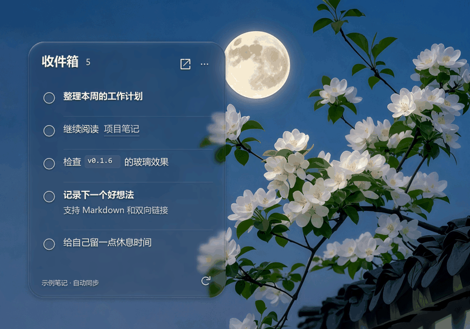

# Obsidian Glass Tasks

Windows 11 桌面待办小窗口，读取一个 Markdown 文件，支持勾选完成、撤销、Markdown 排版和 Obsidian 双链。背景使用实时桌面采样、轻模糊、圆角折射、边缘高光和轻微色散；界面固定暗色主题。



6 秒循环渲染演示。玻璃直接使用项目的 HLSL；示例待办与背景为展示素材。

当前版本：**0.1.5**。程序使用 C++、Win32、D3D11、DXGI Desktop Duplication、DirectComposition 和透明 WebView2，不依赖 Rainmeter。

## 环境要求

- Windows 11 x64、支持 D3D11 的显卡。
- Microsoft Edge WebView2 Runtime。
- PowerShell 7.4 或更高版本，用于任务写回和构建脚本。
- 从源码构建：Visual Studio 2022 C++ Build Tools、Windows SDK 10.0.26100.0、WebView2 SDK 1.0.4258.31。
- 运行 Markdown 测试时需要 Node.js 18 或更高版本。

## 配置笔记

先复制配置示例，再填写自己的路径：

```powershell
Copy-Item -LiteralPath .\resources\config.example.json -Destination .\resources\config.json
```

```json
{
  "vault": "MyVault",
  "sourcePath": "C:\\Notes\\MyVault\\Inbox\\Tasks.md",
  "noteFile": "Inbox/Tasks.md",
  "powershellPath": "C:\\Program Files\\PowerShell\\7\\pwsh.exe"
}
```

- `vault`：Obsidian 中的笔记库名称。
- `sourcePath`：实际 Markdown 文件的绝对路径，文件需要已经存在。
- `noteFile`：同一文件相对笔记库的路径，用于打开 Obsidian。
- `powershellPath`：PowerShell 7 的可执行文件绝对路径，可用 `(Get-Command pwsh).Source` 查询。

`resources/config.json` 属于本机配置，不会提交到 Git。配置示例里的路径不是可直接运行的默认值。程序只显示该文件中的未完成任务，不执行 Obsidian Tasks 的全库查询、不生成循环任务、不自动插入完成日期。

## 构建和安装

在 PowerShell 7 中，从项目根目录运行。先下载并解压固定版本的官方 WebView2 SDK：

```powershell
New-Item -ItemType Directory -Path .\work -Force | Out-Null
curl.exe --fail --location --output .\work\webview2-sdk.zip https://api.nuget.org/v3-flatcontainer/microsoft.web.webview2/1.0.4258.31/microsoft.web.webview2.1.0.4258.31.nupkg
if ($LASTEXITCODE -ne 0) { throw 'WebView2 SDK download failed' }
if ((Get-FileHash -LiteralPath .\work\webview2-sdk.zip).Hash -ne '56F7F4B8BF9AEE4B8EFEFBBDD4F67D5F74EBD1B100ED0806DA71BF76AF481AA9') { throw 'WebView2 SDK checksum mismatch' }
Expand-Archive -LiteralPath .\work\webview2-sdk.zip -DestinationPath .\work\webview2-sdk
pwsh -NoProfile -File .\Build.ps1 -WebView2Sdk .\work\webview2-sdk
pwsh -NoProfile -File .\Install.ps1
```

默认安装到 `%LOCALAPPDATA%\Programs\ObsidianGlassTasks`；可通过 `-InstallDirectory` 指定其他位置。安装脚本拒绝覆盖已有目录，不会修改其他程序，也不会自动创建开机启动项。

```powershell
& (Join-Path $env:LOCALAPPDATA 'Programs\ObsidianGlassTasks\NativeGlassTasks.exe')
```

如需开机启动，可自行把该 EXE 的快捷方式放入 Windows 启动文件夹。修改配置后需要重新构建、安装，或在程序退出后修改安装目录里的 `resources/config.json`。

## 使用

- 拖动标题移动窗口，位置会保存。
- 点空心圆完成任务；底部“撤销”恢复最近一次完成。
- 点标题旁的打开图标进入 Obsidian 笔记；笔记链接直接打开对应笔记。
- 点“…”或右键打开窗口选项：置顶、暂停动态玻璃、刷新、退出。
- 默认是普通浮窗；托盘图标可重新唤出窗口，需要时手动开启置顶。
- 截图前可开启“暂停动态玻璃（便于截图）”。正常模式会从系统捕获结果中排除自身，以避免反复采样自己的倒影。

程序约两秒同步一次笔记。勾选只修改一处 ASCII 方括号状态，保留 UTF-8 文件的 BOM、换行和其他内容。提交前核对原行；文件已被编辑、匹配有歧义或被其他写入者锁定时，明确报错。

窗口状态及不含笔记正文的诊断位于 `%LOCALAPPDATA%\ObsidianGlassTasks`。桌面画面只在本机显卡内参与渲染，不保存画面文件、不上传；只读回变化标志来跳过重复帧。没有监听端口，也没有开启远程调试。

## 材质与边界

材质参考 [liquidglass 的 Dock 预设](https://github.com/shayann07/liquidglass/blob/0cbd5e24058d2fb3fffe45b72cd07915d4dcea6f/liquidglass/src/commonMain/kotlin/com/wexpa/liquidglass/GlassStyle.kt#L672)：中央使用约 2–3 CSS 像素的轻模糊，背景传输系数为 0.85，并降低加亮底色。浅色文字使用细阴影；边缘保留约 28 像素宽的折射区域、方向高光和轻微色散。

0.1.5 将圆角与直边统一为连续折射曲线，替换此前混合的角部翻折映射；折射位移在圆角内部归零，避免四角局部翻折。0.1.4 的透光量与轻模糊保持不变。

背景刷新随显示器刷新率调度，拖动时更新采样坐标；显示队列最多保留一帧，静止背景跳过重复绘制。诊断中的刷新间隔和桌面帧到提交耗时不包含最终显示扫描，不能当作屏幕可见延迟。

这是开源材质公式的局部移植与自有 Windows 渲染，不包含 Apple 私有渲染器，不代表与 iOS 26 完全一致。高透光背景上的原始文字颜色不保证达到 WCAG AA 对比度，文字阴影也不等于整体验收。当前仅验证过一套 NVIDIA 单屏环境；跨显卡多屏、HDR、远程桌面、锁屏恢复和高 DPI 仍需对应环境验证。视觉效果及鼠标操作由使用者核对。

## 检查

构建后执行。每次使用新的临时目录，测试只写入生成的笔记：

```powershell
node --test .\tests\tasks.test.mjs
pwsh -NoProfile -File .\tests\action.tests.ps1 -FixtureRoot .\work\action-fixture
pwsh -NoProfile -File .\tests\native.tests.ps1 -FixtureRoot .\work\native-fixture
```

原生检查覆盖合成背景上的 GPU 折射、四角平滑渐变连续性、透明通道、单像素纹理过滤、16 像素宽横纵条纹保留、背景变化检测，以及 WebView2 桥接、完成与撤销。合成渲染路径不采集桌面。写回测试要求 `testFixture: true`，笔记真实路径必须位于独立测试目录内。

`NativeGlassTasks.exe --stop` 请求正常退出，正在保存时等待操作完成。

## 可选：恢复既有 Rainmeter 皮肤

仅适用于此前已经安装 `MarkdownTasks\Glass` 皮肤的用户。普通安装不需要 Rainmeter。

安装时可传入 `-RainmeterIniPath <现有 Rainmeter.ini 的路径>` 保存一份备份。需要恢复时，在安装目录运行：

```powershell
pwsh -NoProfile -File .\Restore-Rainmeter.ps1 -RainmeterPath 'C:\Program Files\Rainmeter\Rainmeter.exe'
```

该脚本只关闭本程序、移除指向本程序的 `Obsidian Glass Tasks.lnk` 开机快捷方式，并激活已有皮肤；不整文件覆盖 Rainmeter 配置，不修改笔记。窗口菜单的“切回 Rainmeter 版”需要 `Rainmeter.exe` 可从 `PATH` 找到。

第三方来源和许可见 [THIRD-PARTY-NOTICES.md](THIRD-PARTY-NOTICES.md)。
